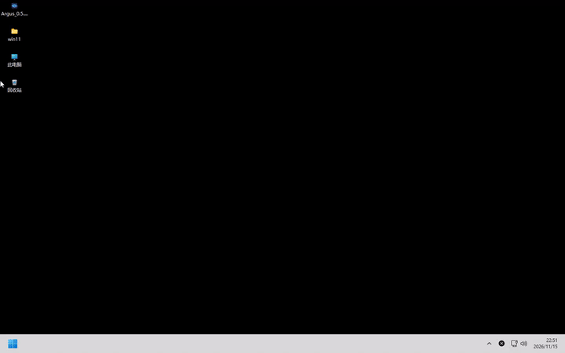
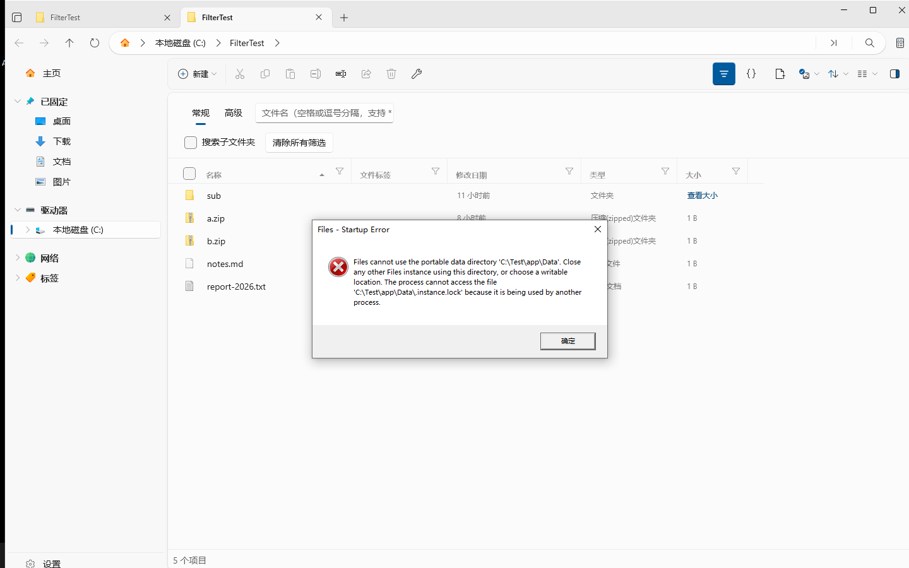

# 示例演示：截图与录屏

这两个演示都在 **Windows 11 虚拟机**（`192.168.221.130`）里真实执行。宿主机只负责构建、投放与回收结果，没有在宿主机上启动被测应用或截取桌面。

## 演示内容

演示套件 `samples/DemoTests/DemoSuite.cs` 驱动 `samples/SampleApp` 完成四个步骤：

| 步骤 | 操作 | 截图 |
| --- | --- | --- |
| `01-launch` | 启动示例应用，确认主窗口 | [win11-01-launch.png](assets/demos/win11-01-launch.png) |
| `02-filter` | 在关键字框输入 `zip`，点击 Apply，断言 2 项 | [win11-02-filter.png](assets/demos/win11-02-filter.png) |
| `03-recurse` | 勾选“Search subfolders”，断言 4 项 | [win11-03-recurse.png](assets/demos/win11-03-recurse.png) |
| `04-clear` | 点击 Clear，断言恢复 3 项 | [win11-04-clear.png](assets/demos/win11-04-clear.png) |

每一步都由 Runner 调用 `context.CaptureScreenshot(...)` 在客户机内截图。录屏演示还会由 Runner 在客户机内启动 ffmpeg `gdigrab`，生成 `session.mp4`。

## 录屏效果



[下载 MP4](assets/demos/session.mp4)（H.264，1440×900，8.3 秒，10 fps）。

> 为了让录屏干净，Runner 启动前会隐藏客户机桌面上残留的控制台窗口；`run.cmd` 也通过 `wscript.exe` 以隐藏窗口运行。

## 异常弹窗检测演示

Win10 测试 VM 上曾经残留一个 `Files - Startup Error` 弹窗，原因是 `C:\Test\app\Data\instance.lock` 被另一个 Files 实例占用。它属于模态窗口，会挡住 Files 的 UI 操作。

现在流水线会在启动应用前检测 `#32770` 对话框。用 Win10 配置运行：

```powershell
$env:VM_WIN10_PASSWORD = '<win10 密码>'
.\vm-ui-pipeline.ps1 -Config .\demos\screenshot.win10.pipeline.json
```

检测结果：

```text
FAIL pipeline :: 运行前检测到异常弹窗：Files - Startup Error [Files:5404]
result: completed（0 通过，1 失败）
```



截图会保存在结果目录的 `win10/screenshots/*-existing-dialog.png`。这次运行没有启动被测应用，因此弹窗不可能干扰测试；如果没有检测，它会被当作正常桌面继续执行。

## 运行

```powershell
# 宿主机上设置 win11 客户机本地管理员密码
$env:VM_WIN11_PASSWORD = '<密码>'

# 截图 + 录屏；需要宿主机 PATH 中有 ffmpeg
.\demos\run-demo.ps1 -Mode both
```

也可以只跑其中一种：

```powershell
.\demos\run-demo.ps1 -Mode screenshot
.\demos\run-demo.ps1 -Mode recording
```

脚本会构建 Runner、示例应用与演示套件，然后调用 `vm-ui-pipeline.ps1`。结果在：

```text
artifacts/demos/<runId>/win11/
├─ summary.json
├─ run.log
├─ results.txt
├─ screenshots/
│  ├─ <time>-01-launch.png
│  ├─ <time>-02-filter.png
│  ├─ <time>-03-recurse.png
│  └─ <time>-04-clear.png
└─ session.mp4          # 仅录屏模式
```

## 直接使用配置文件

```powershell
.\vm-ui-pipeline.ps1 -Config .\demos\screenshot.pipeline.json
.\vm-ui-pipeline.ps1 -Config .\demos\recording.pipeline.json
```

两个配置都使用：

- `guestRoot`：`C:\VmUiPipeline`
- 客户机：`win11` / `192.168.221.130`
- 启动器：WinSimpleSSH（`external/WinSimpleSSH`）
- 录屏：`C:\VmUiPipeline\ffmpeg\ffmpeg.exe`，10 fps

## 换到 Win10 或别的 VM

复制任一配置，修改：

```json
"vms": [
  {
    "name": "win10",
    "address": "192.168.221.128",
    "user": "win10",
    "passwordEnv": "VM_WIN10_PASSWORD"
  }
]
```

然后设置 `$env:VM_WIN10_PASSWORD`，运行：

```powershell
.\vm-ui-pipeline.ps1 -Config .\demos\screenshot.win10.pipeline.json
```

## 说明

- 截图来自真实客户机桌面，分辨率由 VM 显示设置决定（本次为 1440×900）。
- 录屏是证据，不是帧级性能基准；VM 内 10 fps 足够看清操作步骤。
- ffmpeg 与 WinSimpleSSH 都不随仓库分发；演示脚本只负责把本机的 ffmpeg 投放到客户机。
- 演示配置使用 `artifacts/demo` 下的构建产物；该目录被 gitignore，不提交。
